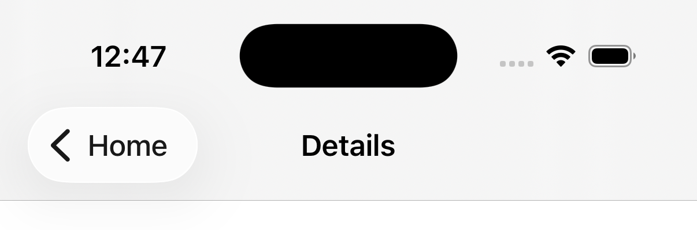
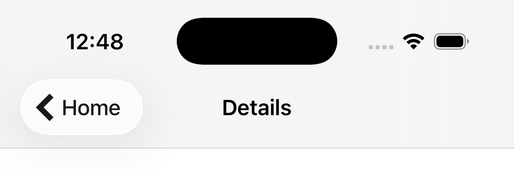
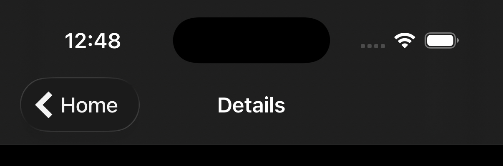
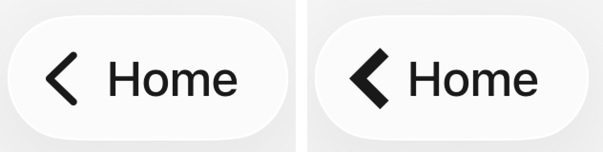

# Back button image can't use a custom SF Symbol

On iOS, `ScreenStackHeaderBackButtonImage` with `source={{ uri: 'custom.chevron.left' }}` shows UIKit's chevron when `custom.chevron.left` is a custom symbol in the app's asset catalog. `loadBackButtonImageInViewController:` in `RNSScreenStackHeaderConfig.mm` only copies the bitmap that the React Native `<Image>` loaded. No React Native image loader resolves a symbol set name, so the bitmap is nil and UIKit keeps its own chevron.

The whole repro is [`App.tsx`](App.tsx) plus one symbol set, [`ios/RNSRepro/Images.xcassets/custom.chevron.left.symbolset`](ios/RNSRepro/Images.xcassets/custom.chevron.left.symbolset). The symbol is a square-ended chevron, so it is easy to tell apart from UIKit's round-capped one.

## Run it

You need Xcode and an iOS simulator.

```sh
npm install
npx expo run:ios
```

Then tap **Open details**.

`ios/` is committed because it holds the symbol set. Don't run `npx expo prebuild --clean`, because it deletes the symbol set.

## Expected and actual

Expected: the back button on the details screen shows `custom.chevron.left`, tinted like the system chevron.

Actual: the back button shows UIKit's chevron.

| Actual (`main`) | With the fix (`with-fix`) | With the fix, dark mode |
|---|---|---|
|  |  |  |

The back button zoomed in, `main` on the left and `with-fix` on the right:



## See the fix

The `with-fix` branch adds [`patches/react-native-screens+4.30.0.patch`](https://github.com/amillez/rns-back-button-custom-symbol-repro/blob/with-fix/patches/react-native-screens%2B4.30.0.patch), which patch-package applies on `npm install`. When the back button image URI has no scheme, the patch asks `[UIImage imageNamed:]` first. On a miss it falls through to the current code.

```sh
git checkout with-fix
npm install
npx expo run:ios
```

## Versions

- react-native-screens 4.30.0
- React Native 0.86.3, New Architecture, Hermes
- Expo SDK 57 (`expo` 57.0.22), debug build
- Xcode 26.6
- iPhone 17 simulator, iOS 26.1

The symbol SVG was drawn for this repo and is public domain (CC0).
